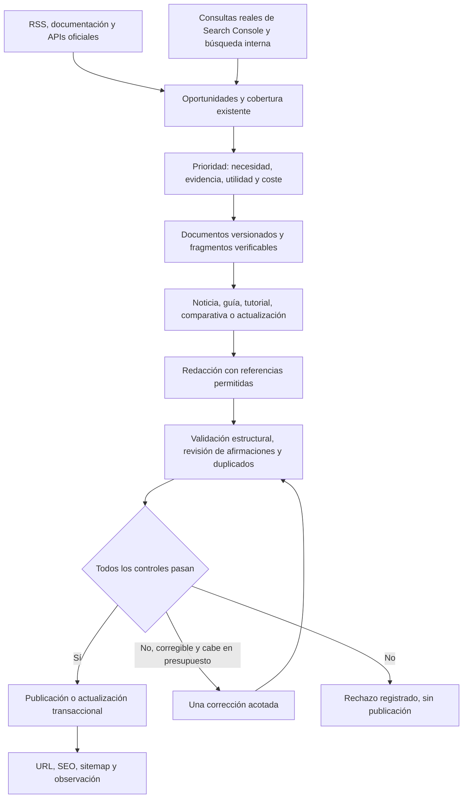

# Redacción autónoma: diagnóstico, preparación local y plan

Estado de esta preparación: cambios locales y simulaciones sin gasto. Posteriormente el propietario autorizó el despliegue y una prueba real: véase [resultado del despliegue y reintento autorizado](RESEARCH_EVIDENCE_DEPLOYMENT_2026_10_24.md). El resto de este documento describe el alcance y las comprobaciones de la preparación anterior; los trabajos futuros de arquitectura siguen pendientes.

## 1. Causa de `invalid_evidence`

Se revisaron RESEARCH_MANUAL_2026_10_24.md, sources.py, writing.py, quality.py, worker.py, config.py, routes.py y sus pruebas. Se analizaron ambas versiones del expediente privado, se consultaron otra vez sus tres fuentes públicas y se contrastó además el HTML de LitPivot guardado en el diagnóstico anterior. Solo se realizaron lecturas del VPS y consultas de fuentes; no se ejecutó el trabajador.

En **ambas versiones** falla el párrafo 1, referencia 2, `source_id=1`, correspondiente a [LitPivot, AI2](https://huggingface.co/blog/allenai/litpivot). La afirmación describe que el sistema divide una propuesta en facetas —problema, contribución y evaluación—.

| Campo | Fragmento relevante |
| --- | --- |
| Cita emitida por el modelo | `facet highlighting, which segments` |
| Texto extraído del HTML | `facet highlighting , which segments` |

El identificador existe. El extractor inserta espacios entre nodos de HTML, incluidos los nodos que separan un término marcado y su coma. El modelo devuelve la puntuación natural sin ese espacio. `normalize()` solo comprime espacios y convierte a minúsculas: no elimina el espacio anterior a la coma. Por tanto, la búsqueda de subcadena falla. La corrección conserva exactamente la misma cita defectuosa y vuelve a fallar. El corrector recibía un código genérico, sin posición ni explicación concreta.

La comparación contra los documentos vueltos a consultar reproduce ese primer fallo en las dos versiones y no encuentra otras citas ausentes. El HTML local anterior también contiene el mismo espacio. **Limitación forense:** el expediente antiguo no guardó el texto exacto usado en aquella ejecución ni su huella; no puede demostrarse la igualdad de todos los bytes históricos. El diagnóstico reproduce la causa concreta compatible con el fallo registrado; no afirma haber recuperado el snapshot inexistente.

No se arregla relajando el validador ni considerando equivalentes citas arbitrariamente parecidas. El modelo deja de transcribir citas: el servidor conserva y resuelve los fragmentos exactos.

## 2. Corrección implementada localmente

### Evidencia antes de redacción

`evidence.py` construye el catálogo determinista antes de la primera llamada. Cada documento conserva URL, título, idioma, organización, fecha publicada, fecha recuperada y texto extraído limitado a 18.000 caracteres. Asigna:

- `source_key`: hash estable de la URL canónica.
- `content_sha256`: versión del contenido exacto.
- `fragment_id`: hash de fuente, versión y offsets del fragmento.
- Fragmentos de hasta 380 caracteres, con offsets verificables contra el documento.

Los identificadores de fuente del colector se derivan de la URL y no de su posición en la descarga. La numeración visible del artículo permanece corta; los identificadores internos no se muestran como números enormes. Se preserva la numeración de los borradores históricos.

El expediente guarda el catálogo completo **antes de pagar**. Sigue siendo privado, con la retención existente de 30 días; no se añade una base de datos paralela ni se altera el histórico económico. Una huella verifica integridad/coherencia, no demuestra que una afirmación del editor original sea verdadera.

### Generación y revisión

El esquema enviado al proveedor para nuevas ejecuciones es `GroundedDraft`: permite texto y referencias `fragment_id`, sin campos para inventar citas ni identificadores de fuente. El servidor comprueba pertenencia al catálogo realmente ofrecido y convierte los identificadores en citas literales. Título y resumen deben señalar fragmentos que también estén atribuidos en el artículo. La compatibilidad interna con `Draft` mantiene los controles y la lectura de expedientes anteriores.

Se mantienen dos organizaciones verificadas, cifras respaldadas, límites de formato, duplicados, ausencia de copia extensa, revisión semántica y publicación transaccional. Se extiende el control de cifras a título y resumen. Un catálogo sin dos organizaciones se rechaza antes de la llamada de redacción.

La revisión usa la misma llamada presupuestada; añade un resultado estructurado para cada título, resumen, encabezado y frase. El servidor comprueba cobertura sin omisiones/duplicados, IDs válidos y que cada frase se evalúe con evidencias citadas en su párrafo. Un identificador real por sí solo **no** demuestra respaldo semántico. Si la revisión marca una afirmación sin soporte, no se publica.

La corrección sigue limitada a una por ejecución y puede eliminar afirmaciones o reducir el alcance. Tiene acceso al catálogo acotado, incluidas alternativas a citas fallidas; no depende de encontrar una cita inválida en el texto para poder repararla. Los fallos deterministas incluyen posición, fuente y motivo; los fallos de generación conservan diagnósticos controlados. No se escriben respuestas del proveedor en logs generales.

El contexto ofrece fragmentos equilibrados entre fuentes, con un máximo de 24.000 bytes UTF-8 de extractos; evita enviar documento completo y fragmentos duplicados. La reserva sigue calculándose sobre **todo** el payload, esquema y salida máxima: este límite de contexto no sustituye el control económico.

### Recuperación permitida

Se preparan dos RSS oficiales adicionales, Microsoft Research y NVIDIA. Ambos devolvieron HTTP 200, XML válido y contenido completo en la comprobación pública. Su funcionamiento con el transporte fijado a IP del VPS se debe comprobar antes de desplegar; la prueba local de disponibilidad usó TLS verificado con el almacén de confianza del entorno.

Ante un 403 se conserva el error y no se reintenta la página. Solo se puede utilizar el `content:encoded` completo de un RSS oficial ya consultado, si supera el mínimo de contenido. Una descripción corta no se convierte en un artículo ni en evidencia de hechos adicionales. El método y URL del feed quedan registrados. En Hugging Face, un RSS sin firma de autor no acredita una organización independiente: se conserva la comprobación estricta de autoría.

No se añade un supuesto API de noticias de OpenAI. Los adaptadores API requieren endpoint público documentado, procedencia, condiciones y pruebas específicas antes de incorporarse. Las [APIs públicas del Hub](https://huggingface.co/docs/hub/api) son una opción para metadatos de modelos, sujeta a sus límites; no sustituyen sin más el contenido de un artículo bloqueado.

## 3. Arquitectura editorial completa propuesta

La siguiente arquitectura es el **diseño objetivo**. El catálogo y el flujo de referencias están preparados; la planificación SEO, actualización de artículos y ejecución de código descritas aquí aún no están implementadas.

**Descubrimiento y demanda.** Ingesta acotada, caché condicional y procedencia. Search Console solo cuando exista integración autorizada de lectura o una importación válida; verificación del dominio no equivale a autorización API. Sin datos, etiquetar como hipótesis editorial, nunca inventar volúmenes ni popularidad. Combinar consultas con impresiones/CTR/posición, preguntas reales y huecos de cobertura, sin inventar usuarios. Priorizar utilidad para la audiencia frente a actualidad por sí sola.

**Selección del trabajo.** Una cola de oportunidades con tema normalizado, intención, categoría, fuentes relacionadas, fecha de caducidad, coste estimado, prioridad y motivo. Puntuar evidencia y utilidad antes que frecuencia. Diferenciar noticias, tutoriales, guías y comparativas; no mezclar tres anuncios inconexos para satisfacer diversidad. El revisor sigue rechazando fuentes sin relación. Añadir agrupación previa y pruebas de precisión antes de pagar una generación. Las señales heurísticas no se presentarán como demanda de búsqueda medida.

**Redacción por tipo.** Noticias: qué cambia, a quién afecta y límites. Guías: solución completa a una necesidad. Comparativas: criterios homogéneos y datos atribuibles por herramienta; no afirmar haber probado productos. Tutoriales: versiones, entradas, comandos, resultados esperados y prueba real registrada antes de afirmar que funcionan. El contenido sin evidencia suficiente se descarta o se reduce a un alcance verificable; la autonomía incluye decidir no publicar.

**Código.** Ejecutor separado y efímero, sin claves ni datos de producción, sin red ni socket Docker, usuario sin privilegios, filesystem de solo lectura salvo temporal y límites de CPU, RAM, tiempo y salida. Dependencias previamente fijadas y disponibles; fixtures y resultados verificables. No ejecutar texto de fuentes directamente en el trabajador. Syntax/compilación no equivale a prueba funcional. Si no existe un entorno permitido para verificar un tutorial, no publicarlo como probado. Este ejecutor todavía no existe.

**Actualizaciones.** Huellas de fuentes, detección de cambios y mapeo artículo→afirmaciones→fragmentos. Generar una revisión del artículo, conservar slug, fecha original y versiones; actualizar fecha solo con cambios sustantivos comprobados. Comparación optimista antes de escribir, nueva validación completa y rollback por versión. Una actualización ocupa el mismo cupo y presupuesto que una pieza nueva; no crear otro trabajador que gaste en paralelo. No retirar artículos solo porque una fuente responda temporalmente 403.

**Supervisión y seguridad.** Registrar por etapa cantidades, duración, códigos HTTP, método de recuperación, catálogo/versiones, afirmaciones rechazadas, correcciones, coste reservado y motivo final. Panel existente como supervisión opcional, sin aprobación humana diaria obligatoria. Preparar alertas de ausencia de ejecución, fallo repetido, publicación fallida y presupuesto mediante un canal autorizado; el SMTP administrativo actual no está configurado para envío. Mantener los logs libres de secretos y datos personales innecesarios.

**SEO y crecimiento.** URLs individuales, canonicals, enlaces relacionados útiles y sitemap automático existentes. Priorizar contenidos propios que resuelvan necesidades concretas; medir clics orgánicos no de marca, consultas, cobertura temática, indexación y lectores recurrentes. No usar el número de artículos ni la puntuación de una herramienta como sustituto de utilidad. El objetivo de 100.000 visitas mensuales es una meta, no una previsión garantizada. El diseño sigue los [criterios de contenido útil de Google Search Central](https://developers.google.com/search/docs/fundamentals/creating-helpful-content): valor original, fuentes y ausencia de experiencias inventadas.

## 4. Plan de implementación y aceptación

Estimaciones de esfuerzo técnico, sin incluir tiempos de Google ni acceso a servicios externos.

| Prioridad | Trabajo | Esfuerzo | Criterio de aceptación |
| --- | --- | --- | --- |
| P0, preparado localmente | Catálogo previo, IDs, revisión con cobertura, regresiones y RSS | 1–2 días de revisión/endurecimiento | Pruebas sin gasto, despliegue autorizado, ejecución natural trazable sin copiar citas |
| P1 | Cola, clasificación de intención y agrupación de fuentes relacionadas | 2–3 días | Casos relevantes seleccionados; anuncios inconexos rechazados antes de generar; sin duplicar oportunidades |
| P1 | Importación de señales reales de demanda y cobertura | 1–2 días | Procedencia visible, sin volúmenes inventados ni permisos de escritura externos |
| P1 | Panel por etapas y alertas | 1–2 días | Se distingue ejecución ausente, rechazo editorial y fallo técnico; no exige intervención para publicar válidos |
| P2 | Plantillas y validadores de noticias, guías y comparativas | 2–4 días | Evaluación de fixtures por intención, evidencia suficiente y ausencia de experiencias inventadas |
| P2 | Sandbox de ejemplos y tutoriales | 3–5 días | Casos funcionales y adversarios, sin red/secretos, límites efectivos y resultados conservados |
| P2 | Actualización autónoma con historial | 3–4 días | No cambia URLs/fecha original; evita sobrescribir cambios concurrentes; rollback de una revisión probado |
| P3 | Evaluación continua de calidad y coste | 1–2 días iniciales | Indicadores por motivo/etapa, sin bucles de pago ni publicación por cuota |

Los trabajos futuros pueden incluir migraciones versionadas para oportunidades, revisiones y pruebas de código. No crear esas tablas manualmente ni añadir infraestructura externa antes de necesitarla. Conservar un único coordinador y cupo económico compartido.

## 5. Pruebas locales y límites

`tests/test_evidence_first.py` incluye el caso mínimo anonimizado del fallo, IDs estables, catálogo alterado, referencias inventadas, metadatos sin atribución, cobertura omitida/duplicada, afirmación rechazada, evidencia ajena, contexto acotado y respaldo RSS con/sin contenido completo.

La simulación llama al pipeline y al adaptador reales, con el transporte del proveedor sustituido por respuestas deterministas y SQLite en memoria. Verifica reserva, borrador, revisión por frase, transacción de publicación y lectura pública de la API. También verifica corrección con publicación y rechazo con invisibilidad. No accede a la base del VPS ni publica una página de prueba. **No demuestra** calidad semántica de una futura respuesta real: demuestra el recorrido y las barreras del software.

Las pruebas opcionales de navegador/infraestructura omitidas deben ejecutarse en su entorno antes del despliegue. No hay cambios de frontend; no se necesita atribuir a este trabajo un nuevo build de Nuxt ni una auditoría visual inexistente.

Resultado final comprobado: `PYTHONPATH=api python -m pytest tests -q` → **131 correctas y 44 omitidas**, incluidas 21 pruebas nuevas de evidencia previa. `python -m compileall -q api/app/research` sin errores. La regresión de numeración visible tuvo inicialmente una aserción que trataba un modelo Pydantic como diccionario; se corrigió la prueba y se repitió la suite completa con el resultado anterior.

Archivos de aplicación preparados: `api/app/research/evidence.py` (nuevo), `sources.py`, `writing.py` y `quality.py`. Pruebas nuevas: `tests/test_evidence_first.py` y `tests/fixtures/research_evidence_spacing.json`. Este documento contiene el diagnóstico, arquitectura y procedimiento propuesto. No hay modificaciones en worker.py, configuración económica, horario, secretos ni frontend.

## 6. Despliegue futuro y verificación real

1. Revisión de los cuatro módulos Python modificados/nuevos y de las pruebas; no hay cambios de dependencias, esquema, variables, presupuesto ni horario.
2. Backup completo cifrado, copia externa y restauración aislada comprobada. Registrar imágenes anteriores y estado/configuración sin imprimir secretos.
3. Comprobar desde el VPS las cinco fuentes, sus redirecciones dentro de allowlist, formatos, fechas y descarga TLS. No ejecutar generación de pago.
4. Revisar si hay investigación activa o borrador pendiente de continuación; desplegar cuando esté inactivo. La compatibilidad de expedientes antiguos se prueba sin forzar ni repetir su fecha.
5. Construir/recrear API y research-worker con los mismos parámetros; frontend, Caddy, PostgreSQL y Redis no requieren cambios de imagen por esta corrección. Verificar migraciones existentes y salud, sin nuevas tablas.
6. Observar la siguiente ejecución natural de las 22:30 Europe/Madrid. Verificar catálogo guardado antes de la llamada, IDs ofrecidos/seleccionados, controles por frase, motivos y reservas ≤0,15 USD/día y ≤5 USD/mes.
7. Si publica: API/URL 200, fuentes y cuerpo coincidentes, canonical/metadatos/JSON-LD y sitemap. Si rechaza: motivos concretos, sin URL pública ni publicación parcial. No reintentar automáticamente para conseguir una publicación.
8. Ante error crítico, volver a las imágenes anteriores. Los expedientes nuevos añaden campos JSON y no requieren restaurar la base sobre datos nuevos; no borrar publicaciones, reservas ni registros. Conservar el backup como recuperación de desastre, no como rollback rutinario que pierda escrituras.

Una ejecución válida con un artículo útil es la primera comprobación en producción, no una promesa de publicación diaria. Con fuentes insuficientes, contenido inconexo, código no comprobable o presupuesto agotado, el sistema debe seguir rechazando automáticamente y explicarlo.
